# Hi, I'm Jayanti 👋

I'm a computer science graduate who enjoys building web and mobile applications, backend services, and small projects that explore networking, computer vision, and algorithms.

## Languages I've used

- **Python** — networking, Django applications, and computer vision with OpenCV
- **JavaScript and TypeScript** — web and mobile apps, including React, Next.js, NestJS, and React Native
- **Java** — Spring Boot services, Android coursework, and object-oriented projects
- **Also explored:** Go, C, C++, PHP, and shell scripting

These reflect languages used across my public projects; the mix varies by project and coursework.

## GitHub activity

